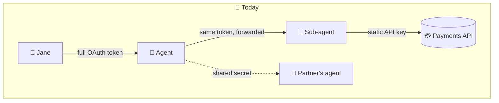
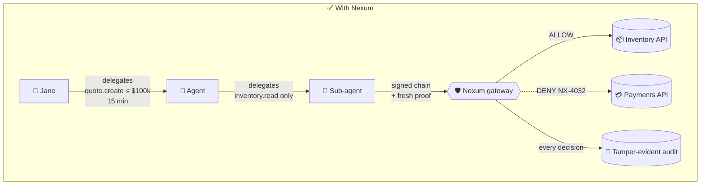
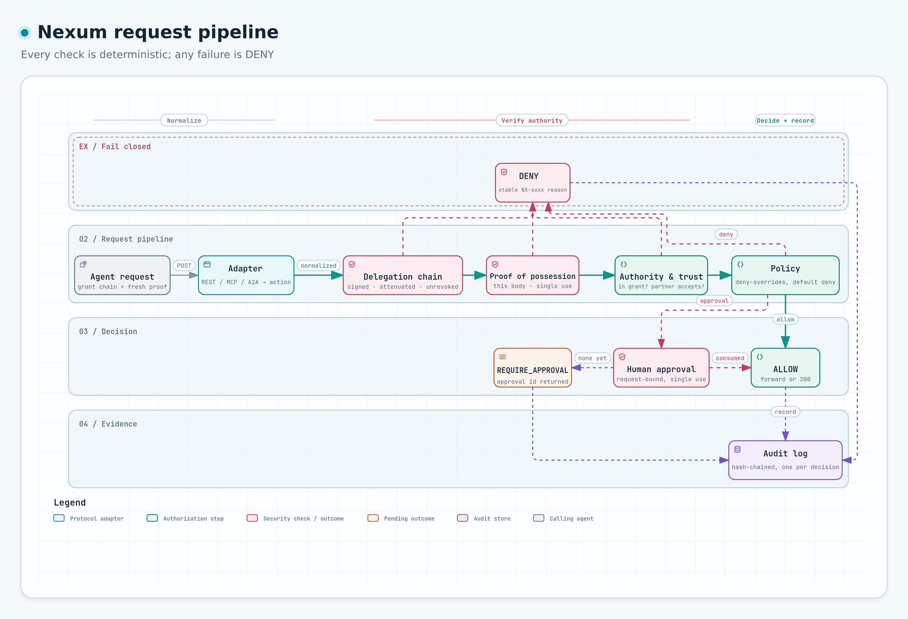
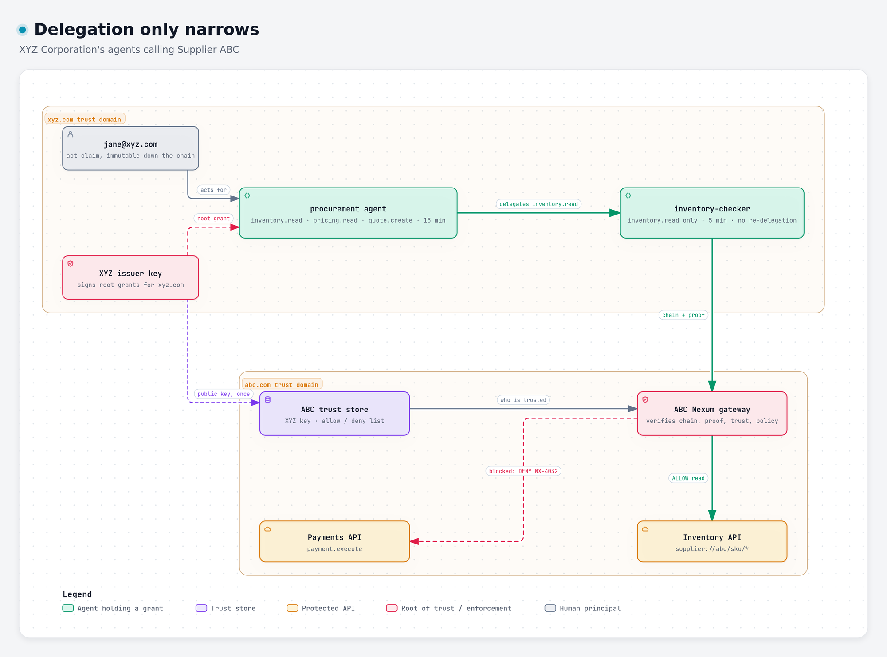
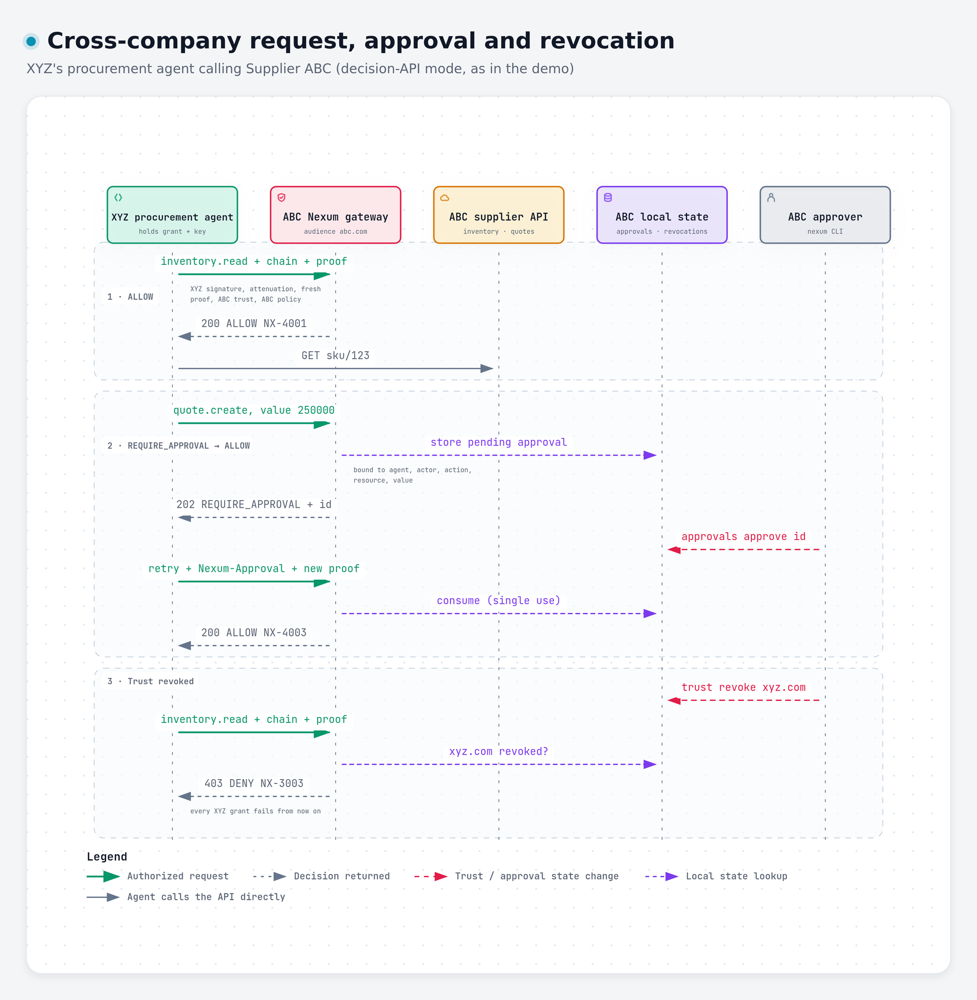

<div align="center">

# Nexum

### The open trust & authorization layer for AI agents

**Know who every agent is, who it acts for, what it was delegated, and stop everything else.**

[](https://github.com/swaroski/nexum/actions/workflows/ci.yml)
[](LICENSE)
[](https://www.rust-lang.org)
[](ROADMAP.md)
[](#security-model)

[Quick start](#-quick-start) ·
[Use cases](#-use-cases) ·
[How it works](#-how-it-works) ·
[Demo](#-the-cross-company-demo) ·
[Architecture](ARCHITECTURE.md) ·
[Threat model](THREAT_MODEL.md)

</div>

---

## The problem

AI agents now call APIs, run tools, move money and talk to *other companies'*
agents. Most of them do it with a long-lived API key or a forwarded user token,
and the only thing between a prompt injection and a $50,000 refund is the
model's judgment.



Nobody can answer the questions that matter: *Which agent did this? On whose
behalf? Who gave it that power? Was it allowed to pass it on? Can we turn it
off right now? Can the partner verify any of it without trusting us blindly?*

## What Nexum does

Nexum is a small, fast **gateway** that sits in front of your tools, APIs and
agents. Every request carries **cryptographic proof of delegated authority**,
and the gateway decides deterministically, inside your own environment:



| | |
|---|---|
| 🪪 **Agent identity** | Every agent gets its own [SPIFFE](https://spiffe.io) ID, separate from the human using it. |
| 🔗 **Delegation that only shrinks** | Each hop can only *narrow* capabilities, resources, value limits, audience and lifetime. Enforced cryptographically. |
| 🔑 **No bearer tokens** | Each request carries a one-time signature by the agent's key over the exact body. Stolen grants and replayed requests fail. |
| 🤝 **Cross-company trust** | A partner verifies your agents with *your* public key under *their* policy. No shared secrets, and no vendor in the middle. |
| ⚖️ **Three outcomes** | `ALLOW`, `DENY`, or `REQUIRE_APPROVAL` with single-use human approvals bound to the exact request. |
| ⛔ **Instant revocation** | Kill an agent, a grant, a key or a whole partner relationship. Every descendant grant dies with it. |
| 🧾 **Audit you can verify** | One hash-chained event per decision. `nexum audit verify` detects edits, deletions and reordering. |
| 🔌 **Protocol adapters** | REST decision API, **MCP** tool-call enforcement, **A2A** message enforcement. |

> **LLMs propose. Deterministic systems authorize.** No prompt, model output or
> agent message can change what an agent is allowed to do.

## 🎯 Use cases

<table>
<tr>
<td width="50%" valign="top">

### 💸 Customer-support refunds with limits
A support agent can refund up to **$500** on its own. Above that, Nexum returns
`REQUIRE_APPROVAL`, a human approves *that exact refund*, and the agent retries.
A prompt-injected "refund $50,000" never reaches the payments API.

</td>
<td width="50%" valign="top">

### 🏢 Agent-to-agent across companies
Your procurement agent asks a supplier's agent for prices and quotes. The
supplier verifies your agent cryptographically, applies *its own* policy, and
can cut you off with one command. → [demo](#-the-cross-company-demo)

</td>
</tr>
<tr>
<td valign="top">

### 🧰 An MCP tool firewall
Put Nexum in front of MCP servers. Each `tools/call` maps to a capability:
`read_file` is allowed, `delete_repo` is denied, `deploy_prod` needs approval.
Works with any MCP client that can sign requests.

</td>
<td valign="top">

### 🪆 Safe sub-agent orchestration
An orchestrator spawns workers and hands each a **narrower** grant that is
scoped to one task, one resource prefix and five minutes. A worker can't
escalate, re-delegate beyond its depth, or outlive its parent.

</td>
</tr>
<tr>
<td valign="top">

### 🏥 Purpose-bound data access
Grants carry a `purpose` (e.g. `claims-review`) and an actor (`dr.lee@clinic`).
Policy can require both, and the audit log records them, which is the trail
regulated teams need for HIPAA, SOX and GDPR reviews.

</td>
<td valign="top">

### ⏱️ Zero standing privilege
Long-running autonomous agents hold **no permanent permissions**. Each task
gets a short-lived grant, which expires or is revoked when the task ends. If an
agent's credentials leak, they are worthless without its key.

</td>
</tr>
<tr>
<td valign="top">

### 🌐 Multi-vendor agent fleets
A LangGraph agent on AWS calls a Mastra agent on Azure that uses an MCP tool on
GCP. Nexum sees only identities, delegations, actions and policy, whatever the
framework, cloud or model.

</td>
<td valign="top">

### 🔍 Security review & incident response
`nexum policies test` answers "would this be allowed?" before you deploy.
`nexum eval run` replays attack scenarios (escalation, replay, stolen grants,
tampering, revocation, prompt injection…) through the real pipeline in CI,
with no real keys. `nexum trace inspect` shows which check decided and how
authority travelled.
`nexum audit search` answers "what did this agent do, and for whom?" after an
incident, from a log you can prove hasn't been altered.

</td>
</tr>
</table>

## ⚡ Quick start

```bash
# Prebuilt binary (Linux, macOS, Windows): https://github.com/swaroski/nexum/releases
# or: docker pull ghcr.io/swaroski/nexum:0.1
cargo install --locked --git https://github.com/swaroski/nexum --tag v0.1.0 nexum

nexum init --domain example.com        # config, trust store, starter policy, org key
nexum agents register --id spiffe://example.com/agents/support-bot --name support-bot
nexum grants issue --sub spiffe://example.com/agents/support-bot \
  --holder .nexum/keys/support-bot.key.json \
  --cap refund.create --res 'app://orders/*' --aud example.com --out bot.jwt
nexum gateway start &

nexum call --grant bot.jwt --key .nexum/keys/support-bot.key.json \
  --action refund.create --resource app://orders/42 --value 1700
```

```text
APPROVAL REQUIRED NX-4002

  Agent:      spiffe://example.com/agents/support-bot
  Requested:  refund.create  app://orders/42
  Value:      1700
  Reason:     Policy requires human approval for this action.
  Policy:     example.com-default / refund-approval
  Approval:   01a1999a-6988-77d1-8883-a360a450ad5e
```

<details>
<summary><b>🐳 Run with Docker</b></summary>

```bash
NEXUM_DOMAIN=example.com docker compose -f deploy/docker/docker-compose.yml up -d
curl localhost:8080/healthz                                   # ok
docker compose -f deploy/docker/docker-compose.yml exec nexum nexum doctor
```

The container runs as a non-root user with a read-only root filesystem.
Config, keys, state and audit live in the `nexum-data` volume.

</details>

<details>
<summary><b>☸️ Kubernetes</b></summary>

A minimal manifest is in [`deploy/kubernetes/nexum.yaml`](deploy/kubernetes/nexum.yaml).
It is single-replica on purpose in v0.1 (replay cache and state are per instance).

</details>

## 🔍 How it works

### Every request, eight deterministic checks

<p align="center">
  <a href="docs/diagrams/request-pipeline.html">
    <picture>
      <source media="(prefers-color-scheme: dark)" srcset="docs/diagrams/request-pipeline.dark.png">
      
    </picture>
  </a>
  <br><sub>Each box links to the code that implements it · <a href="docs/diagrams/request-pipeline.html">interactive version</a> (download and open in a browser) · <a href="docs/diagrams/request-pipeline.json">source</a></sub>
</p>

Anything unknown, unverifiable or unavailable is a **DENY** with a stable
reason code (`NX-xxxx`). There is no "warn and continue" path.

### Delegation only ever narrows

<p align="center">
  <a href="docs/diagrams/delegation-chain.html">
    <picture>
      <source media="(prefers-color-scheme: dark)" srcset="docs/diagrams/delegation-chain.dark.png">
      
    </picture>
  </a>
  <br><sub>Two trust domains, one verifiable chain of authority · <a href="docs/diagrams/delegation-chain.html">interactive version</a> (download and open in a browser) · <a href="docs/diagrams/delegation-chain.json">source</a></sub>
</p>

`authority(child) ⊆ authority(parent)`, checked on every hop, every request,
and property-tested. A sub-agent can't add capabilities, outlive its parent,
or re-delegate beyond its depth.

### Cross-company trust without a middleman

<p align="center">
  <a href="docs/diagrams/cross-company.html">
    <picture>
      <source media="(prefers-color-scheme: dark)" srcset="docs/diagrams/cross-company.dark.png">
      
    </picture>
  </a>
  <br><sub>The demo, step by step · <a href="docs/diagrams/cross-company.html">interactive version</a> (download and open in a browser) · <a href="docs/diagrams/cross-company.json">source</a></sub>
</p>

XYZ never shares a secret with ABC, and ABC never trusts a third party. Each
organization stays its own root of trust.

## 🎬 The cross-company demo

```bash
git clone https://github.com/swaroski/nexum && cd nexum
./examples/cross-company/demo.sh
```

Two organizations are initialized from scratch. ABC's gateway starts, and
XYZ's agents exercise it:

| # | Who | Asks for | Result | Why |
|---|---|---|---|---|
| 1 | procurement | `inventory.read` | ✅ `ALLOW` | in grant, trusted, policy allows |
| 2 | inventory-checker (delegated) | `inventory.read` | ✅ `ALLOW` | valid attenuated delegation |
| 3 | inventory-checker | `payment.execute` | ⛔ `DENY NX-4032` | not present in the delegation chain |
| — | inventory-checker | *mint itself* `payment.execute` | ⛔ refused | `NX-1015` parent forbids further delegation |
| 4 | procurement | `quote.create` $250,000 | ⏸️ `REQUIRE_APPROVAL` | policy: approval above $100k |
| 5 | procurement + approval | same quote | ✅ `ALLOW NX-4003` | approved, consumed once |
| 6 | procurement | anything | ⛔ `DENY NX-3003` | ABC revoked trust in XYZ |

```text
$ nexum audit verify
audit chain intact: 6 events
```

## 🔌 Integrations

| Surface | Endpoint | Status |
|---|---|---|
| **REST decision API** | `POST /v1/authorize` | ✅ alpha |
| **MCP** (spec 2026-07-28, Streamable HTTP) | `POST /mcp/{server}` | 🧪 experimental · [guide](examples/mcp) |
| **A2A** (v1.0 JSON-RPC, v0.3 aliases) | `POST /a2a/{agent}` | 🧪 experimental · [guide](examples/a2a) |
| **Python client** | [`nexum_client.py`](examples/python/nexum_client.py) | 🧪 experimental |
| **LangGraph** | [`examples/langgraph`](examples/langgraph/agent.py) | 🧪 experimental |
| OPA · Cedar · Cerbos · SpiceDB | `PolicyDecisionPoint` trait | 🗺️ [roadmap](ROADMAP.md) |
| SPIRE · Entra · Okta · AWS · GCP identity | identity adapters | 🗺️ [roadmap](ROADMAP.md) |

<details>
<summary><b>Example policy</b></summary>

```yaml
apiVersion: nexum.dev/v1alpha1
kind: Policy
id: abc-supplier-v1
subjects: [{ organization: xyz.com }]
rules:
  - { action: inventory.read,  resource: "supplier://abc/*", effect: allow }
  - { action: quote.create,    effect: allow,    conditions: { max_value: 100000 } }
  - { action: quote.create,    effect: approval, conditions: { value_above: 100000 } }
  - { action: payment.execute, effect: deny }
delegation:
  allowed: [inventory.read, pricing.read]   # what sub-agents may exercise
  max_depth: 2
```

Deny-overrides, default deny, unknown fields rejected.

</details>

<details>
<summary><b>Example trust store</b></summary>

```yaml
apiVersion: nexum.dev/v1alpha1
trust_domains:
  xyz.com:
    issuer: https://identity.xyz.com
    keys: [{ kty: OKP, crv: Ed25519, x: "…", kid: "lCLq5SsW…" }]   # standard JWKS
    allow: [inventory.read, pricing.read, quote.create]
    deny:  [payment.execute, customer.export]
    max_grant_ttl_seconds: 3600
```

</details>

## 🧭 What Nexum is, and isn't

| ✅ Nexum is | ❌ Nexum is not |
|---|---|
| A local enforcement gateway + CLI | A hosted service you must trust |
| Identity, delegation, trust, policy, audit | An LLM, agent framework or prompt tool |
| Built on SPIFFE, JOSE, OAuth `act`/`cnf`, MCP, A2A | A new PKI, IdP or crypto scheme |
| An adapter host for OPA, Cedar, your PDP | A replacement for your authorization stack |
| Cloud-, model-, framework-neutral | Tied to any vendor |

## Security model

* **Ed25519 only** (`alg: EdDSA`), strict verification; `none`/HMAC/key-URL headers rejected.
* **Holder-of-key grants + per-request proofs** bound to body, grant and gateway; single use.
* **Fail closed** on every error, including policy, state and audit failures.
* **No credentials forwarded** upstream; no tokens or payloads in logs or audit.
* `unsafe` forbidden in every runtime crate (the only exception is the
  browser playground's ~40-line wasm shim, never run server-side);
  attack-named negative tests, property tests, and a 94-scenario security eval
  suite on every commit.

Read the full [threat model](THREAT_MODEL.md) (24 threats, mitigations and
residual risks). Report vulnerabilities privately per [SECURITY.md](SECURITY.md).

> **Status:** v0.1, `nexum.dev/v1alpha1`. Not yet independently
> security-reviewed. Don't make it your only control for high-impact actions yet.

## 🛠️ CLI

```text
nexum init | doctor | call | console
nexum eval      run [paths] [--json] [--baseline results.json]
nexum trace     inspect <request-or-trace-id> [--audit …] [--json]
nexum risk      scan [--json]
nexum discover  a2a <url>…
nexum gateway   start
nexum agents    register | list | inspect [--a2a-card] | revoke
nexum grants    issue | delegate | inspect [--verify] | revoke
nexum trust     list | add | revoke | revoke-key
nexum policies  validate | test | simulate <proposed.yaml> [--fail-on-widen]
nexum approvals list | approve | reject
nexum audit     tail | search | verify
```

Every decision runs in a `nexum.authorize` tracing span with stable
`nexum.*` attributes and a `nexum.security_event` for alert-worthy denials.
Set `NEXUM_LOG_FORMAT=json` for log pipelines, or `OTEL_EXPORTER_OTLP_ENDPOINT`
to export spans to a local OpenTelemetry Collector; a caller's W3C
`traceparent` links decisions across gateways. The official security suite
lives in [`evals/`](evals) (`nexum -c evals/gateway/nexum.yaml eval run evals`),
and this repository is a GitHub Action for running your own suites in CI.
`nexum console` is a local web UI over one gateway (decisions, traces,
agents, trust, approvals); OPA can replace the built-in policy engine
([`examples/opa`](examples/opa)); a [browser playground](https://swaroski.github.io/nexum/playground/)
runs the decision pipeline in WebAssembly. Where Nexum is going:
[docs/PLATFORM.md](docs/PLATFORM.md).

## Principles

**Neutral by design** · **Customer-controlled trust** · **Local enforcement** ·
**Least privilege** · **Short-lived authority** · **Delegation only attenuates** ·
**Deterministic security** · **Open standards first** · **Auditable by default** ·
**Fail closed**

## Contributing

Issues and PRs welcome. See [CONTRIBUTING.md](CONTRIBUTING.md),
[ARCHITECTURE.md](ARCHITECTURE.md) and the [roadmap](ROADMAP.md).

<div align="center">

Licensed under [Apache-2.0](LICENSE)

</div>
